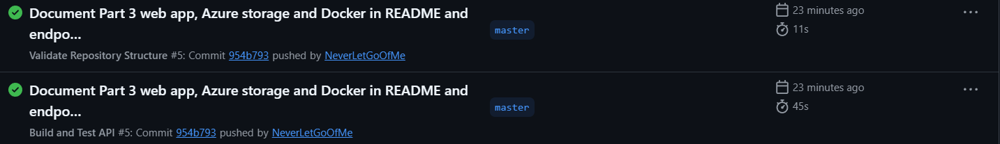

# RaceDay

RaceDay is a web-based event management system for the South African road running, walking and cycling community. Organisers create and manage events, categories and results, while participants browse events, enter them and track their own results.

The project is built in three parts:

| Part | Content | Folder |
|---|---|---|
| 1 | System planning: ERD, endpoint plan, SQL script | `/docs` |
| 2 | RESTful API in C# with unit tests and CI/CD | `/Part2` |
| 3 | MVC web application, Azure Blob Storage and Docker | `/Part3` |

## User roles

- **Organiser** - can create, edit and delete their own events, manage the categories of those events, capture participant results, and view all enrolments for their events.
- **Participant** - can register, browse events and categories, enter an event by choosing a category, view their own enrolments, and view their own results.

Both roles can view and update their own profile. Role rules are enforced on the API: a participant calling an organiser endpoint (or the other way round) gets a `403 Forbidden`, and anyone who is not logged in gets a `401 Unauthorized` on protected endpoints.

## Part 1 - Planning documents (`/docs`)

- `RaceDay_ERD.png` - entity relationship diagram (six entities: Roles, Users, Events, Categories, Enrolments, Results)
- `RaceDay_Endpoint_Plan.md` - the API endpoint plan
- `RaceDay_Schema.sql` - SQL Server script that creates and seeds the database

## Part 2 - RaceDay API (`/Part2`)

- `RaceDay.Api` - ASP.NET Core Web API (Microsoft, 2026), Entity Framework Core (Microsoft, 2026), Swagger (OpenAPI Initiative, 2026)
- `RaceDay.Tests` - xUnit tests (xUnit.net, 2026)

### Setup and run

1. Install the .NET 10 SDK, Visual Studio and SQL Server (Microsoft, 2026) (Express is fine). Make sure the SQL Server service is running.
2. Clone the repository.
3. Open `Part2/RaceDay.Api/appsettings.json` and check the `DefaultConnection` string matches your SQL Server instance (the default is `localhost\SQLEXPRESS`).
4. Create the database from the migrations. In Visual Studio open **Tools > NuGet Package Manager > Package Manager Console**, select `RaceDay.Api` as the default project, and run:
   ```
   Update-Database
   ```
   (or from a terminal in `Part2/RaceDay.Api`: `dotnet ef database update`)
5. Run the `RaceDay.Api` project. Swagger opens at `https://localhost:<port>/swagger`.
6. To run the tests: `dotnet test Part2/RaceDay.Tests/RaceDay.Tests.csproj` (or Test Explorer in Visual Studio).

### Using the API through Swagger

1. Call `POST /api/auth/register` once as an Organiser and once as a Participant.
2. Call `POST /api/auth/login` with one of them. The browser keeps the session cookie, so all the other endpoints now work as that user.
3. Call `POST /api/auth/logout` and log in as the other role to see the role rules (for example, creating an event as a Participant returns 403).

### Authentication design

- Passwords are hashed with PBKDF2 (random salt, 100 000 iterations) before they are stored (NIST, 2010). The original password is never saved.
- Logging in stores the user's ID and role in a server-side session (OWASP, 2024). Protected endpoints use a `[SessionAuthorize]` attribute that reads the session: no session gives 401, the wrong role gives 403.
- Organisers can only change their own events (and the categories, enrolments and results that belong to them), so one organiser cannot edit another organiser's event.
- Registration lets a user choose Organiser or Participant, as the brief describes. In a real product, organiser accounts would need approval; I kept self-selection to match the brief.

### Differences from Part 1

- The login now uses sessions instead of JWT tokens, because the Part 2 brief requires session management. I added `POST /api/auth/logout` for this reason.
- `Distance` and `EventType` (Run, Walk, Cycle) moved onto Events, as the Part 2 brief requires, and `Distance` was removed from Categories. The ERD, SQL script and endpoint plan were updated to match.
- Added `GET /api/results/me` so participants can view their own results.
- The database is created by EF Core migrations (Code-First), so column types are EF's defaults (for example `nvarchar` instead of `varchar`). The tables, columns and relationships match the ERD. The SQL script in `/docs` is the Part 1 design and seed data.

## Part 3 - RaceDay web application (`/Part3`)

`RaceDay.Web` is an ASP.NET Core MVC application that gives Organisers and Participants a website for RaceDay. It never touches the database or Azure directly. Every action is a call to the Part 2 API, so all the business rules (roles, ownership checks, duplicate enrolments and so on) stay in one place.

### What each role sees

- **Organiser:** dashboard (events created, upcoming events, enrolments per event), event management (create, edit, delete, banner upload), category management, an enrolments page with status control, and a results page to capture finish times and positions.
- **Participant:** upcoming events with filters (search, type, date), event details with categories, enrolment, My Enrolments (colour-coded status), My Results (for example "47th out of 312 finishers") and a profile page with picture upload.

Each role has its own navigation menu. Pages are protected: someone who is not logged in is sent to the login page, and the wrong role is sent to an "access denied" page.

### How login works across the two projects

The API remembers a logged-in user with a session cookie. The MVC app calls the API from the server, so after a successful login it stores that API cookie in its own session and sends it with every later API call. The MVC session also holds the user's ID, name and role, which the menus and page checks use. Logging out clears both sessions.

### Azure Blob Storage

Image uploads (event banners and profile pictures) go from the website to the API, and the API stores them in a private Azure Blob Storage container. The website shows images by asking the API for them, so the browser and the MVC app never talk to Azure.

1. In the Azure Portal, create a Storage account.
2. Copy its connection string (Security + networking > Access keys).
3. Running locally: from `Part2/RaceDay.Api` run
   ```
   dotnet user-secrets init
   dotnet user-secrets set "AzureStorage:ConnectionString" "<your connection string>"
   ```
4. Running in Docker: copy `.env.example` to `.env` and paste the connection string into it. `.env` is git-ignored, so the key is never committed.

### Run it locally (without Docker)

1. Apply the database migrations: from `Part2/RaceDay.Api` run `dotnet ef database update`.
2. Start the API: `dotnet run` in `Part2/RaceDay.Api` (it listens on http://localhost:5032, check `Api:BaseUrl` in `Part3/RaceDay.Web/appsettings.json` matches).
3. In a second terminal, start the website: `dotnet run` in `Part3/RaceDay.Web` and open the address it prints.

### Run it with Docker (one command)

Install Docker Desktop, then from the repository root run:

```
docker compose up --build
```

This starts SQL Server, the API (which creates the database on first start) and the website. Open http://localhost:8081 for the website and http://localhost:8080/swagger for the API. The containerised website behaves the same as the local one. Stop everything with `docker compose down`.

The `Dockerfile` in `Part3/RaceDay.Web` uses a multi-stage build: the .NET SDK image restores and publishes the app, and a smaller ASP.NET runtime image runs it as a non-root user.

### Changes to the API for Part 3

- Events store a `BannerImage` and users store a `ProfilePicture` (names of the blobs in Azure).
- New endpoints: `GET /api/events/mine`, `POST /api/events/{id}/banner`, `POST /api/users/me/picture`, `GET /api/images/{name}`, `PUT /api/enrolments/{id}/status`. `GET /api/events` accepts `type`, `search` and `from` filters, and results now include the event date and the total number of finishers in the category.
- Results are published as soon as an organiser captures them.
- The full list is in `docs/RaceDay_Endpoint_Plan.md`.

## CI/CD

Two GitHub Actions workflows (GitHub, 2026) run on every push:

- `validate-repo.yml` - checks the repository structure (`/docs` files, Part 2 projects and this README).
- `build-and-test.yml` - builds the API and runs all unit tests.

Green build screenshot:



## AI tool disclosure

I used Claude (Anthropic) to help plan the database and API structure and to produce first drafts of the diagram, SQL script and code. I reviewed, ran and changed this work myself.

## References

Fielding, R.T., 2000. *Architectural Styles and the Design of Network-based Software Architectures*. Doctoral dissertation. University of California, Irvine. Available at: https://ics.uci.edu/~fielding/pubs/dissertation/rest_arch_style.htm [Accessed 16 October 2026].

GitHub, 2026. *GitHub Actions documentation*. Available at: https://docs.github.com/en/actions [Accessed 16 October 2026].

Microsoft, 2026a. *ASP.NET documentation*. Available at: https://learn.microsoft.com/en-us/aspnet/core/ [Accessed 16 October 2026].

Microsoft, 2026b. *Overview of Entity Framework Core*. Available at: https://learn.microsoft.com/en-us/ef/core/ [Accessed 16 October 2026].

Microsoft, 2026c. *SQL Server technical documentation*. Available at: https://learn.microsoft.com/en-us/sql/sql-server/ [Accessed 16 October 2026].

NIST, 2010. *Recommendation for Password-Based Key Derivation Part 1: Storage Applications*. NIST Special Publication 800-132. Available at: https://nvlpubs.nist.gov/nistpubs/Legacy/SP/nistspecialpublication800-132.pdf [Accessed 16 October 2026].

OpenAPI Initiative, 2026. *OpenAPI Specification*. Available at: https://swagger.io/specification/ [Accessed 16 October 2026].

OWASP, 2024. *Session Management Cheat Sheet*. OWASP Cheat Sheet Series. Available at: https://cheatsheetseries.owasp.org/cheatsheets/Session_Management_Cheat_Sheet.html [Accessed 16 October 2026].

xUnit.net, 2026. *Getting Started with xUnit.net v3*. Available at: https://xunit.net/docs/getting-started/v3/getting-started [Accessed 16 October 2026].
